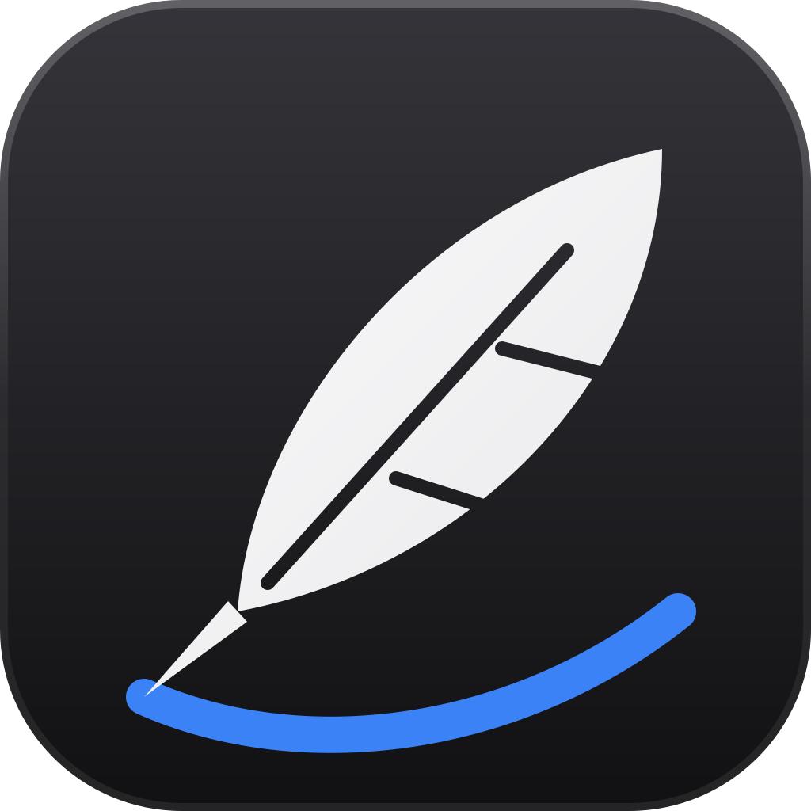

# Quill

Quill (formerly Pencraft) is a canvas design editor, written in Rust. It opens
`.pen` files. You
draw frames, shapes, text and paths on an endless canvas, turn layers into
components, lay them out in rows and columns, and export them as PNG, JPEG,
WebP, PDF or SVG. An AI assistant is built in: it works on the document in
front of you, and any AI client that speaks MCP can do the same through
`pencraft mcp`.

It runs on Windows and macOS.

## What it does

- **Designs on a canvas.** Frames, rectangles, ellipses, polygons, text,
  sticky notes, icons and pen paths with editable points; fills, strokes,
  shadows, blurs and shader effects.
- **Components and layout.** Reusable components with instances, variables
  and light and dark themes, and flex layout that arranges children by
  itself.
- **Reads and writes `.pen` files faithfully.** It opens them and exports
  them (File › Export .pen File…). Keys Quill does not know survive, and
  a file Quill wrote is byte for byte the same when it is read and
  written again. Quill adds one key of its own, `pencraft`,
  which says what the design uses that only Quill draws.
- **One file per design.** Save writes a `.quill` file that holds the design
  with its pictures and shader files, to send or to keep. A `.pen` file you
  open is saved as a `.quill` file of the same name beside it.
- **Exports.** Any layer to PNG, JPEG, WebP, PDF or SVG.
- **An assistant in the app.** The chat talks to Claude through the
  installed Claude Code program or a provider's API with your key, and a
  second model can review each finished design.
- **A door for other AI clients.** `pencraft mcp` lets Claude Code, Cursor,
  Codex and others read and change open documents, also while Quill is in
  the background. See [app/AI.md](app/AI.md).
- **Updates itself.** When a newer release is out, a card in the app shows
  what is new; one click downloads it, installs it and starts the new version.

## Install

Download from the [latest release](https://github.com/AsP3X/pencraft/releases/latest):

| File | Use it when |
|---|---|
| `pencraft-<version>-setup.exe` | Windows 10 or 11, 64-bit. A setup wizard that can install for you only, without administrator rights. **Recommended on Windows.** |
| `pencraft-<version>-x64.msi` | Windows, for all users: a Windows Installer package, for example to deploy it. |
| `pencraft-<version>-x64.exe` | Windows, just the program. Put it anywhere and run it. |
| `pencraft-<version>-macos-universal.dmg` | macOS 11 or newer, Apple Silicon and Intel. Open it and drag the app to Applications; it is still named Pencraft there, so that copies already installed keep updating. |

Each release lists the SHA-256 of its files in `SHA256SUMS.txt`.

The files are not code-signed, and the Mac app is not notarised by Apple.
That is why the first start needs one extra step:

- **Windows.** SmartScreen shows "Windows protected your PC". Choose
  **More info**, then **Run anyway**.
- **macOS.** The first start is stopped with "Apple could not verify
  Quill is free of malware". Open **System Settings → Privacy &
  Security**, scroll to the message about Quill, and choose **Open
  Anyway**. This is needed once.

There are no downloads for Linux yet; see [Building](docs/BUILDING.md).

## Quick start

1. Start **Quill**. The home screen lists recent files and starts a new
   design.
2. Press `R` and drag to draw a rectangle, `T` for text, `F` for a frame.
   `Ctrl+P` (`⌘P` on a Mac) searches every action.
3. Type into the message box at the bottom to have the assistant design or
   change something. [app/AI.md](app/AI.md) explains how to connect a model.
4. `Ctrl+S` saves the design as a `.quill` file.

On a Mac the menus are in the menu bar and shortcuts use `⌘`; on Windows the
menus are behind `☰` in the tab strip and the same shortcuts use `Ctrl`.

## Updating Quill

Quill asks GitHub for the latest release when it starts, and once a day
while it stays open. When there is a newer one, a card in the corner of the
window names the version and shows what is new, with three choices:

- **Update and restart** downloads the new version, checks the file against
  the release's checksums, asks about unsaved designs, installs it and
  starts Quill again. Your settings stay. On Windows a small progress
  window shows the install; a Quill installed for all users asks for
  administrator rights once.
- **Download** is what the button reads when this copy can't replace itself:
  it was installed with the MSI, is the plain program, or is a Mac app
  outside a folder it may write to. It opens the installer in your browser;
  run it like the first time.
- **Skip this version** never offers that version again.
- **Later** hides the card until the next start.

The check sends nothing but the app's name and version. If GitHub cannot be
reached, nothing happens and nothing is shown. To look yourself, search the
actions (`Ctrl+P`) for **Check for updates…**. To switch the check off, turn
off **Settings → General → Look for new versions**, or start with
`--no-update-check`.

## Documentation

- [The app](app/README.md): command line, project layout
- [AI models](app/AI.md): the chat, providers, and `pencraft mcp`
- [Mechanics](app/MECHANICS.md): every rule and number Quill uses
- [Building](docs/BUILDING.md): building from source, the checks, installers
- [Releasing](docs/RELEASING.md): how a release is made and how the update check works
- [Changelog](CHANGELOG.md)

## Contributing

Bug reports, ideas and pull requests are welcome. Start with
[CONTRIBUTING.md](CONTRIBUTING.md). Please report security problems privately,
as [SECURITY.md](SECURITY.md) describes.

## License

Quill is source-available under the
[Apache License 2.0 with the Commons Clause](LICENSE).

In short: you may use it, also at work, change it, and share it, for free.
You may not sell it, or sell a product or service whose value comes mainly
from it. Because of that condition it is not "open source" as the Open Source
Initiative defines the term. The [LICENSE](LICENSE) file is what counts; this
paragraph is only a summary.

The bundled [Lucide](https://lucide.dev/) icons are under the
ISC licence.
